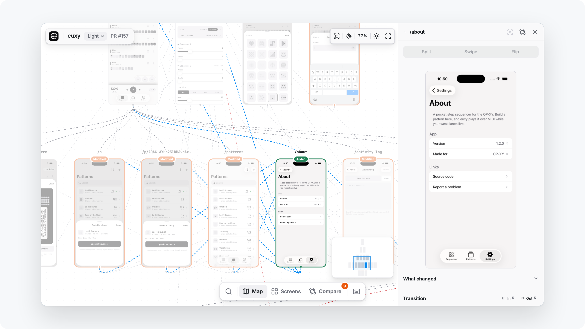
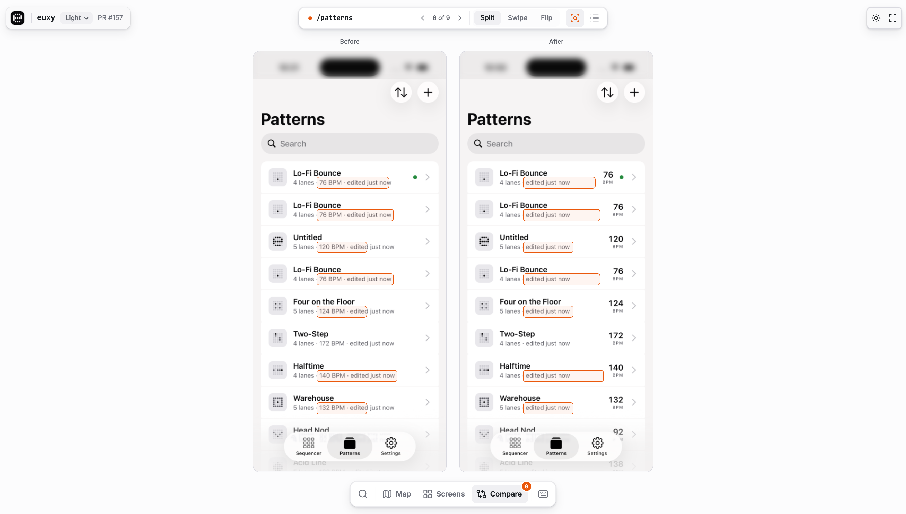

# Expo Explore

Explore maps your app: a screenshot of every screen, connected by the taps between them. On each pull request it captures the screens the PR changes, before and after, on EAS Simulator, and posts a visual review.

<picture>
  <source media="(prefers-color-scheme: dark)" srcset="docs/screenshots/readme-hero-dark.png">
  
</picture>

**See a real report:** [euxy](https://explore-example--euxy.expo.app/p/rfcoic27ccgnrmzgijubxkmuzmptcrva?platform=ios), a MIDI sequencer, reviewed by Explore. It is redeployed with the current Viewer on every merge to main.

<details>
<summary><strong>Requirements</strong></summary>

- An iOS app, an Android app, or both. Explore is in v0; Android capture is newer than iOS.
- Expo SDK 57 or newer, with Expo Router (57 or newer) or React Navigation (6 or newer).
- An EAS build profile per platform: `ios.simulator: true` for iOS, `android.buildType: apk` for Android. Its EAS environment cannot have secret-visibility variables.
- EAS Simulator access (in preview, [join the waitlist](https://expo.dev/services/simulators)).
- Node.js 24.12 or newer, and admin access to the GitHub repository.

</details>

## Quick start

Review a change to your own app, on your machine. You need an Expo SDK 57+ app with Expo Router or React Navigation, Node.js 24.12+, and EAS Simulator access ([join the waitlist](https://expo.dev/services/simulators)). No API keys, no CI.

From your app's directory:

1. **Make the app buildable on EAS, if it is not yet.**

   ```sh
   npx eas-cli@latest login
   npx eas-cli@latest init
   ```

   Then set `ios.bundleIdentifier` in your app config, add a simulator profile to `eas.json`, and commit. The review builds your last commit as the "before".

   ```json
   { "build": { "explore": { "ios": { "simulator": true } } } }
   ```

2. **Change a screen, then review the change.** Edit some text near the top of a screen (Explore captures the first screenful) and run:

   ```sh
   npx @expo/explore capture
   ```

   Explore builds your last commit and your uncommitted changes on EAS, captures the screens the changes can affect, before and after, on EAS Simulator, and opens the report in your browser. The first run waits for an EAS build; later runs reuse it while your native code is unchanged.

Or paste this into Claude Code or Codex from your app's directory:

```text
Show me an Expo Explore review of a change to this app. Follow the "Review a change on
this machine" section of https://unpkg.com/@expo/explore/skills/explore-setup/SKILL.md.
If the app cannot build for the iOS Simulator on EAS yet, set that up (an EAS project,
ios.bundleIdentifier, an "explore" profile with ios.simulator: true) and ask me before
you commit it. If I have no uncommitted changes, change some text near the top of a
screen. Then run npx @expo/explore capture and open the report.
```

Explore uses its defaults until you run `npx @expo/explore setup`, which writes `.expo-explore/config.yaml` for you to change. Next: [review every pull request](#set-up-ci).

## Map every screen of any app

To map every screen of an app instead, with no config, paste this into Claude Code or Codex from your app's directory. It explores a build you point to, or an Expo project straight from its source:

```text
Show me Expo Explore working on this app. Follow
https://unpkg.com/@expo/explore/skills/explore-binary/SKILL.md and run Explore with
npx @expo/explore. If I point you to a build, explore that. Otherwise, if this is an
Expo project, run it from source without making a new build; if it is not, get a
simulator build of it. If the app needs a sign-in, ask me for a test account the way
the skill describes, never for a password in chat. Give me the report link, and if I
need to log in to something first, tell me the command.
```

For apps behind a sign-in, see [Sign-in and other app state](#sign-in-and-other-app-state).

<details>
<summary><strong>Run it yourself</strong></summary>

```sh
npx @expo/explore explore:binary ./my-app.apk   # Android APK
npx @expo/explore explore:binary ./my-app.app   # iOS simulator build (.app, .tar.gz, or simulator .ipa)
```

Explore starts an EAS Simulator, installs the build, taps through the app with your Claude Code or Codex login, and prints a link to the hosted report.

</details>

<details>
<summary id="options"><strong>What it needs, and its options</strong></summary>

- An EAS login (`eas whoami`) and a `claude` or `codex` login, or `ANTHROPIC_API_KEY` / `OPENAI_API_KEY`.
- A simulator build. A device `.ipa` or an `.aab` is rejected before a session starts.
- Platform, bundle id, name, and version are read from the build; you pass nothing else.
- A run stops after 15 minutes, 40 screens, or 150 actions (`--max-duration-minutes`, `--max-screens`, `--max-actions`).
- Buttons that delete, pay, sign out, send, or leave the app are never tapped. `--allow-destructive "Clear cache"` allows one by label.
- `--hints "…"` tells the model what to focus on or how to sign in ([details](#sign-in-and-other-app-state)).
- The hosted link lasts 7 days (`--expires-in 30d|never`). `--no-upload` keeps the report local, and `--json` prints the result for scripts.
- For a link that stays the same from run to run, pass `--alias NAME` and set `EXPLORE_PREVIEW_TOKEN` to a fixed 32-character token.
- Read a local result with `expo-explore view --dir <folder>`, `screen:list`, or `gap:list`.

</details>

<details>
<summary><strong>Explore a simulator session you already started</strong></summary>

If the app is already running on an `agent-device` EAS Simulator session, Explore can start from there. It leaves your session running.

```sh
eas simulator:start --type agent-device --out-config-type dotenv   # then agent-device install / open
npx @expo/explore explore:session                                   # session from ./.env.eas-simulator, app = the one in the foreground
npx @expo/explore explore:session <session-id> --env-file path/.env.eas-simulator --bundle-id com.example.app --upload
```

`--bundle-id` picks the app when the foreground one is ambiguous. `--upload` hosts the report instead of opening it locally.

</details>

<details>
<summary><strong>What a run without source shows</strong></summary>

One card per screen the run reached, laid out by how many taps it took, with the tapped control on each edge. There is no before and after; that needs [CI](#set-up-ci).


</details>

### Review a change before you push it

The review a PR gets also runs on your machine, between any two commits, with your committed `.expo-explore/config.yaml` or, before you have one, [the defaults](#quick-start). No tokens or keys to set: it uses your `eas login` and your Claude Code or Codex login.

```text
Review my current changes with Expo Explore. Follow the "Review a change on this machine"
section of https://unpkg.com/@expo/explore/skills/explore-setup/SKILL.md, compare my
branch (with my uncommitted changes) against main, and open the report.
```

Every run is kept on your machine for 30 days. `npx @expo/explore reports` lists your local reviews, explorations and uploaded reports with their commits, and reopens or hosts one without capturing again:

<picture>
  <source media="(prefers-color-scheme: dark)" srcset="docs/screenshots/readme-reports-dark.png">
  
</picture>

<details>
<summary><strong>Run it yourself</strong></summary>

```sh
npx @expo/explore capture               # HEAD and your uncommitted changes, against where HEAD left the default branch
npx @expo/explore capture --committed   # HEAD alone
npx @expo/explore capture --base v1.3.0 --head v1.4.0 --scope all --upload
```

- It checks out both commits as temporary worktrees, installs their dependencies, captures every configured platform on EAS Simulator (`--platform` picks one), and opens the report in a local Viewer. `--upload` hosts it and prints the link; `report:upload <report.zip>` hosts one you already have.
- Your checkout, index and branches are never touched. Your uncommitted changes, untracked files included, are reviewed as `eas build` would upload them; `--committed`, or `cli.requireCommit: true` in `eas.json`, leaves them out.
- It runs both commits' code on your machine, as you: installing their dependencies, evaluating the app config, and bundling the JavaScript. That is what checking them out and running them would do, so review only commits you would run, and someone else's branch only if you trust it.
- Installs run without credential environment variables, which keeps tokens out of reach of a registry a commit's `.npmrc` names; that is not a sandbox. A registry that needs `${NPM_TOKEN}` in the project's `.npmrc` must be authenticated in your own `~/.npmrc`.
- Captures are cached in `~/.cache/expo-explore`, so the same base is not captured twice (`--no-cache` skips it); a capture unused for 30 days goes, and the cache stays under 2 GB. Ctrl+C stops the run's simulator sessions.
- Like a CI review, it builds on EAS (reusing a matching build) and runs simulator sessions: expect several minutes and EAS usage.
- Saved runs take up to 2 GB in all, the oldest going first. `reports add <report.zip>` keeps a report you downloaded, such as a PR's `explore-review` artifact.

</details>

## Set up CI

Explore runs in your repository's GitHub Actions in two ways, both from the same setup: a review on every pull request, and a comparison of any two commits, such as a release against the last one.

### Review on every PR

Each pull request gets a comment linking its report: the screens it added, removed or changed, before and after, on each platform you capture. Paste this into Claude Code or Codex from your app's repository:

```text
Set up this app for Expo Explore CI reviews. Follow
https://unpkg.com/@expo/explore/skills/explore-setup/SKILL.md and run Explore with
npx @expo/explore. Recommend a capture mode, start from doctor --json, read the app's
source for the state each screen needs, and repeat doctor until it reports no problems.
Ask me only for what you cannot find in the repository. When you are done, tell me
what to merge and how to start the first review.
```

<details>
<summary id="hosted-previews"><strong>Hosted previews</strong></summary>

By default reviewers download the report from GitHub. With hosted previews, the comment's **Explore report** link opens it in one click, even in private repositories.

```yaml
report:
  preview:
    hosting: eas        # default: off
    expiresAfter: 30d   # default 30d, max 365d, or never
    # project: acme-explore   # default <repository name>-explore, created on first run
```

- Run `expo-explore setup --workflows` after enabling it to add the `deploy` job.
- A [comparison of two commits](#compare-any-two-commits) links its hosted report from the run's summary instead of a PR comment. `capture --upload` on your machine deploys to the same project with your `eas login`.
- `expo-explore report:upload <report.zip>...` hosts reports already on your machine the same way: a review's reports (one per platform, from `capture --output` or a downloaded `explore-review` artifact) or an `explore:binary` report.
- `EXPO_TOKEN` must be able to create the EAS project, so use a [robot user's](https://docs.expo.dev/accounts/programmatic-access/) token.
- The report is encrypted, and only a request carrying the link's token can open it. Treat the link like a shared file link; see [report access](docs/private-review.md#hosted-previews).

</details>

<details>
<summary><strong>Manual setup</strong></summary>

The prompt above walks through these steps with you. To do them yourself:

1. Run `npx @expo/explore setup` in your app's directory (in a monorepo, add `--project apps/mobile`). It writes `.expo-explore/config.yaml` and the workflows.
2. Run `npx @expo/explore doctor` and fix each problem it reports, until it exits 0. `doctor --capture` captures the committed app on EAS once, to check every screen before your first PR.
3. Set the repository secrets `doctor` lists:
   - `EXPO_TOKEN`: create it in [Expo access tokens](https://expo.dev/settings/access-tokens). For [hosted previews](#hosted-previews), use a [robot user](https://docs.expo.dev/accounts/programmatic-access/) that can create projects.
   - A secret for each `{{secret:NAME}}` in your setup steps. Run `npx @expo/explore setup --workflows` after you add one.
4. Commit, merge to the default branch, and run **Expo Explore baseline** from GitHub Actions.
5. Open a PR. **Expo Explore review** runs and posts a comment with the report. To see a whole review of your branch first, run `npx @expo/explore capture` on your machine.

A failed run shows an error code and a next action in the PR comment; see [CI troubleshooting](docs/quickstart-ci.md#diagnose-a-failed-run).

</details>

<details>
<summary><strong>Capture modes: deterministic or agent</strong></summary>

| | **Deterministic** (recommended to start) | **Agent** |
| --- | --- | --- |
| Cost | EAS and GitHub Actions only | Also model usage billed by [OpenAI](https://developers.openai.com/api/docs/pricing) or [Anthropic](https://platform.claude.com/docs/en/about-claude/pricing) |
| Reaching screens | Opens each screen by deep link, with route parameters from the config | Claude Code or Codex navigates the UI |
| App state (signed in, onboarded) | Fixed setup steps in the config | English instructions that the agent follows |
| Unexpected UI | Capture stops with diagnostics | The agent tries to recover |

Both modes use the same comparison rules and report. You can change modes later.

**To use agent mode:**

1. Create an [Anthropic](https://platform.claude.com/settings/keys) or [OpenAI](https://platform.openai.com/api-keys) API key.
2. Set `mode: agent` and an `agent.model` your account can use.
3. Store the key as the repository secret `ANTHROPIC_API_KEY` or `OPENAI_API_KEY`. A key that is not workspace-scoped also needs the `ANTHROPIC_WORKSPACE_ID` variable.
4. Export the key and run `expo-explore doctor --check-model`.

The model navigates and recovers on each uncaptured revision; see [agent usage](docs/quickstart-ci.md#agent-usage-and-reuse).

</details>

<details>
<summary id="platforms"><strong>iOS, Android, or both</strong></summary>

`app.platform` names the primary platform, and a `platforms` map adds the other. Each entry can set its own `device`, `bundleId`, and `easProfile`.

```yaml
app:
  platform: ios
  bundleId: com.example.myapp
  easProfile: explore
device:
  name: iPhone 17
platforms:
  ios: {}
  android:
    device: pixel_7
    bundleId: com.example.myapp
    easProfile: explore-android   # android.buildType: apk in eas.json
```

- The workflows run one capture job per platform, and the PR gets one comment with a section per platform.
- A failed platform fails the check; the other platform's report still publishes.
- An Android-only app sets `app.platform: android` with no `platforms` map.

</details>

<details>
<summary><strong>Keep your setup current</strong></summary>

- A PR that adds a guarded screen or a dynamic route should also update `config.yaml`.
- Renamed identifiers or labels break deterministic setup steps.
- To update Explore, run `npx @expo/explore@latest setup --workflows` and commit the new version. It also adds `explore-compare.yml` if you don't have it, and `doctor` warns when it is missing.

</details>

### Compare any two commits

A release, a release candidate, a nightly: any two branches, tags or commits, reviewed like a PR without one, with the report linked from the run's summary. Once CI reviews PRs, paste this into Claude Code or Codex:

```text
Set up Expo Explore to review this app's releases. Follow the "Compare any two commits"
section of https://unpkg.com/@expo/explore/skills/explore-setup/SKILL.md: make sure
explore-compare.yml is installed, add a workflow that compares each release tag (and
release candidate) with the last stable release, then run it once on the latest tag and
give me the report link.
```

There are a few ways to snapshot a release:

- **On demand:** in your repository's Actions tab, open **Expo Explore compare**, choose **Run workflow**, and set `base` to the last release's tag (`v1.3.0`), `head` to the new tag or release candidate (`v1.4.0-rc.1`), `scope` to `all` and `expires-in` to `never`. The run's summary links the report.
- **Automatically, on every tag:** add the `release-review.yml` in [The comparison workflow](#compare) below. It compares each tag, release candidates included, with the last stable tag, so a release candidate is reviewed against what people have now.
- **On your machine, without CI:** `npx @expo/explore capture --base v1.3.0 --head v1.4.0 --scope all --upload`, with your `eas login`. `npx @expo/explore reports` lists the runs you have kept.

`scope: all` captures every screen, not only those whose source changed, so the report shows the whole release with what changed since the last one marked; `expires-in: never` keeps its link.

<details>
<summary id="compare"><strong>The comparison workflow</strong></summary>

`.github/workflows/explore-compare.yml` reviews a `head` against a `base`, each a branch, tag or commit SHA, with no pull request. It captures, compares and reports exactly like a PR review, and links the report from the run's summary.

Run it from the Actions tab, or call it from a workflow on any event:

```yaml
# .github/workflows/release-review.yml: each release tag (or release candidate) against the last stable release
on:
  push:
    tags: ['v*']
jobs:
  previous:
    runs-on: ubuntu-latest
    outputs: { tag: '${{ steps.tag.outputs.tag }}' }
    steps:
      - uses: actions/checkout@v4
        with: { fetch-depth: 0 }
      # The newest earlier tag that is not a prerelease (v1.4.0-rc.1 has a "-"); none for the first release.
      - id: tag
        run: echo "tag=$(git describe --tags --abbrev=0 --exclude '*-*' "$GITHUB_REF_NAME^" 2>/dev/null || true)" >> "$GITHUB_OUTPUT"
  explore:
    needs: previous
    if: needs.previous.outputs.tag != ''
    permissions: { contents: read, actions: read }
    uses: ./.github/workflows/explore-compare.yml
    with:
      base: '${{ needs.previous.outputs.tag }}'
      head: '${{ github.ref_name }}'
      scope: all          # every screen, not only those whose source changed
      expires-in: never   # keep the hosted link (with report.preview.hosting: eas)
    secrets: inherit
```

- Pick whatever `base` the event calls for: `main` for a release branch, yesterday's tag for a nightly, the last stable tag for a release candidate.
- `scope` and `expires-in` are optional and override `exploration.scope` and `report.preview.expiresAfter` for that run. Without them a comparison captures what a PR review would (`scope: changes` captures only screens whose source changed), and the hosted link expires like a PR's.
- The run summary links each platform's report (**Open** and **zip**, like a PR comment) and, with hosting, the hosted report.
- `setup --workflows` installs it from 0.19.0; `npx @expo/explore@latest setup --workflows` adds it to an existing setup. The caller grants `contents: read` and `actions: read`; `secrets: inherit` passes `EXPO_TOKEN` and any app-test secrets.
- Call it once per workflow run. A called workflow runs inside its caller's run, so a second call in the same run would reuse the first one's artifact names; use separate workflows instead.
- When the baseline workflow captured `base` in the last 30 days, that capture is reused and only `head` is captured. The report artifact is kept 30 days; only a hosted link with `expires-in: never` lasts longer.

</details>

## Sign-in and other app state

Each run starts on a fresh install. Tell Explore how to get past what the app needs: with `--hints` when running without source, or with [setup steps or agent instructions](docs/quickstart-ci.md#when-the-config-needs-setup-steps) in CI.

**Signing in.** Use a test account. Put the password in an environment variable and refer to it as `{{secret:NAME}}`:

```sh
export APP_TEST_PASSWORD=...   # or keep it in a gitignored .env file and source it
npx @expo/explore explore:binary ./my-app.app \
  --hints "Sign in as explore-test@example.com with {{secret:APP_TEST_PASSWORD}}"
```

The model only sees the reference, and Explore types the value. The value is redacted everywhere, and a screen that shows it gets no screenshot, so keep non-sensitive values like a test email as plain text. In CI, store the value as a repository secret instead.

If the sign-in can't be typed (one-time codes, email links, Sign in with Apple or Google), sign in by hand on a session and run `explore:session`. Explore never taps Sign out.

**Other common blockers:**

| The app… | What to do |
| --- | --- |
| Starts with onboarding | `--launch-url myapp://home` to skip it, or a hint ("skip the tour") |
| Needs data to show a screen | A test account that has it, and a hint saying where ("open the first project") |
| Asks for a permission | Explore denies it. Allow it by hand on a session, then run `explore:session` |
| Has a paywall | An account that already has the entitlement; purchase buttons are never tapped |
| Has a safe button that looks destructive | `--allow-destructive "Clear cache"` |
| Is large | [Raise the budgets](#options) (15 minutes, 40 screens, 150 actions by default) and use `--hints` to set priorities |

When a run stops early, `gap:list --dir <output>` says what blocked it.

## What you get

### A comment on every PR

The report links, a row per platform, and the added, removed and modified screens.

<picture>
  <source media="(prefers-color-scheme: dark)" srcset="docs/screenshots/readme-pr-comment-dark.png">
  
</picture>

### Compare

Each changed screen before and after, with the changed regions outlined.

<picture>
  <source media="(prefers-color-scheme: dark)" srcset="docs/screenshots/readme-compare-dark.png">
  
</picture>

### Screens

Every capture, in a section per route folder, with a route tree whose folders fold away and a **Changed** / **All** filter.

<picture>
  <source media="(prefers-color-scheme: dark)" srcset="docs/screenshots/readme-screens-dark.png">
  
</picture>

### Ask an agent about it

Paste this into Claude Code, Codex, Cursor, or any tool that can fetch a URL. In the Viewer, **Hand off to AI** fills it in for you:

```text
Review the visual changes in this PR. Expo Explore report: <report link>

Fetch the link first. It explains the report's JSON API. Go through the changed screens,
compare the before and after screenshots, and tell me which changes look intended and
which look like regressions. For each regression, name the source file to fix.
```

<details>
<summary><strong>Terms in the report</strong></summary>

- **Screen**: one route of the app, with its screenshot.
- **Transition**: one screen leading to another, with the control that was tapped.
- **Baseline**: the capture of the default branch. A review compares a PR's capture against it.
- **Screen variant**: another screenshot of an unchanged screen, such as signed in or in dark mode. It is a different state, not a change in the PR.

</details>

<details>
<summary id="agents"><strong>How agents read a report</strong></summary>

The same link answers differently depending on who asks. It already carries the token, so there is nothing to install.

- A browser gets the Viewer.
- Anything that does not ask for HTML (`curl`, `fetch`, agents' URL tools) gets a Markdown index of the report, also at `/llms.txt`.
- The index links to a read-only JSON API under `/api/v1`: `/screens?status=modified,accessibility-only,added,removed`, `/screens/<id>`, `/transitions`, and `/raw` for the report file.
- Reports without source also expose `/journeys`, `/gaps`, and `/frontier`.
- Multi-platform reports take `?platform=ios|android`. Expired links answer `410`.

```sh
curl -s "$LINK/api/v1/screens?status=modified" | jq '.items[] | {route, status, review}'
```

</details>

## Additional information

<details>
<summary><strong>How it works</strong></summary>

1. The review workflow runs on open, non-draft PRs from the repository whose author has write access. Bots such as Devin go under `ci.trustedAuthors` in `.expo-explore/config.yaml`.
2. Explore reads the diff and your router source to pick the affected screens.
3. It builds both revisions and captures each screen on EAS Simulator, reusing a baseline of the base commit when one exists.
4. It compares the captures. A screen with a source change is **Modified** if its captures differ.
5. It uploads the report to GitHub Actions and posts a PR comment.

The same review runs for any two commits without a PR ([`explore-compare.yml`](#compare-any-two-commits), linking the report from the run summary) and on your machine (`capture`, [above](#review-a-change-before-you-push-it)). The workflows' logic lives in `expo-explore ci:*` commands, so a fix reaches CI with the `@expo/explore` version the workflows pin.

Reports and baselines are kept for 30 days and diagnostics for 7. Hosted deployments are never deleted automatically; see [report access](docs/private-review.md).

</details>

<details>
<summary><strong>Known limitations</strong></summary>

- Android capture has had less use than iOS. The first Android device is `pixel_7`.
- PRs from forks are not reviewed.
- Each route gets one capture per appearance (light and dark with `capture.appearance: auto`). Other states, such as modals, are planned.
- The launch is captured once per appearance and compared like any screen. The comment says how long the splash stayed as it first appeared, when it first changed (a native launch screen handing over to an app-drawn one, an animation starting on it), and when the first screen settled. `capture.launch: video` adds a recording; a launch too fast to observe is reported as "no splash observed".
- On Android the splash usually shows only in the recording, which needs `ffmpeg`. The generated workflows install it.
- Hosted acceptance of agent mode with an API key is incomplete.

</details>

- [CI quick start](docs/quickstart-ci.md): config reference, troubleshooting, and agent usage
- [Capture reviews](docs/public-capture-review.md): how Explore plans, captures, and compares screens
- [Report access](docs/private-review.md): who can open a report and where it is stored

## Inspiration

Explore builds on two projects that map apps from what they render. [screenmap](https://github.com/aleqsio/screenmap) by [@aleqsio](https://github.com/aleqsio) captures the screens a PR changes. Revyl's [Atlas](https://revyl.com/atlas/) maps an app's screens and transitions from how it behaves at runtime.

## Contributing

<details>
<summary><strong>Build, test, and release</strong></summary>

```sh
npm ci
npm run typecheck
npm test
```

- `npm test` rebuilds the CLI and the Viewer first, because the node tests run the compiled `dist/`. After one `npm run build`, `npm run test:node` skips the rebuild.
- The agent runtimes and `eas-cli` are optional dependencies that only capture needs. Do not install with `--omit=optional`, which also drops esbuild's platform package.
- To release, bump `version` in `package.json` and merge to main. The [publish workflow](.github/workflows/publish.yml) publishes any version npm does not have yet.

```sh
npx playwright install chromium
npm run test:viewer:e2e
npm run test:viewer:artifacts
```

To run the full CI pipeline against a sample app, see the [local CI test harness](test/ci/README.md). [ARCHITECTURE.md](ARCHITECTURE.md) describes the source layout and [CI-FLOW.md](CI-FLOW.md) the review pipeline.

</details>

## License

[MIT](LICENSE)
