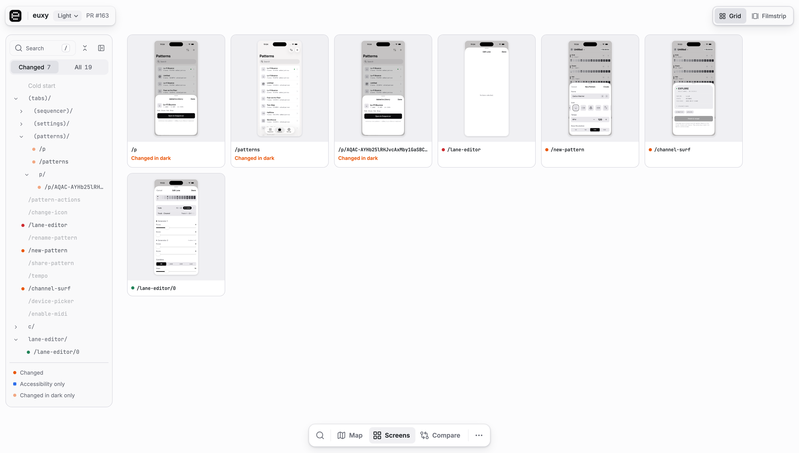
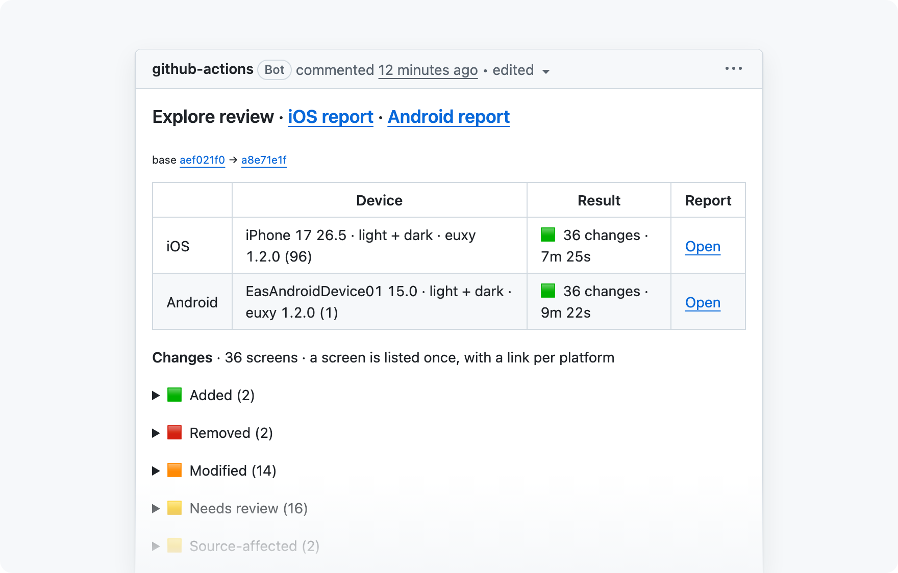
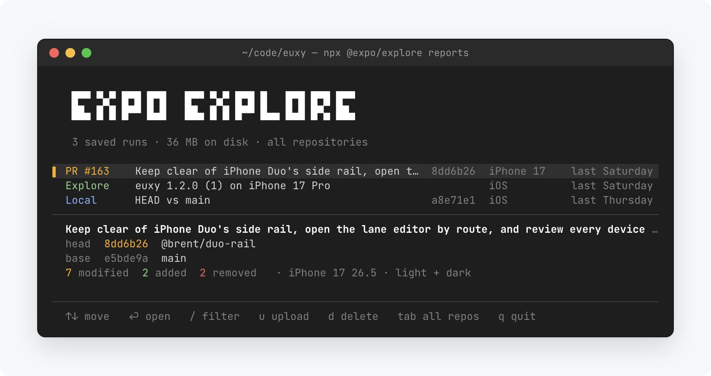
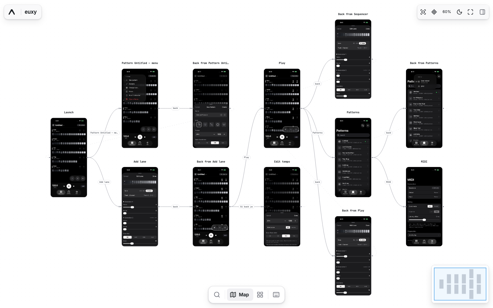
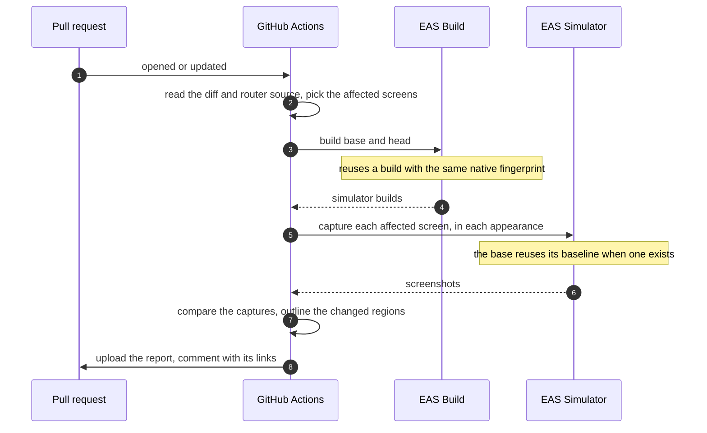

# Expo Explore

Explore maps your app: a screenshot of every screen, connected by the taps between them. On each pull request it captures the screens the PR changes, before and after, on EAS Simulator, and posts a visual review. On your Mac it can also run on a local simulator.

<picture>
  <source media="(prefers-color-scheme: dark)" srcset="docs/screenshots/readme-hero-dark.svg">
  
</picture>

**See a real report:** [euxy](https://explore-example--euxy.expo.app/p/rfcoic27ccgnrmzgijubxkmuzmptcrva?platform=ios), a MIDI sequencer, reviewed by Explore. It is redeployed with the current Viewer on every merge to main.

<picture>
  <source media="(prefers-color-scheme: dark)" srcset="docs/screenshots/readme-compare-dark.svg">
  
</picture>

**Compare**: each changed screen before and after, with the changed regions outlined on the after.

<table>
<tr>
<td width="50%" valign="top">
<a href="docs/screenshots/readme-screens-light.png">
<picture>
  <source media="(prefers-color-scheme: dark)" srcset="docs/screenshots/readme-screens-dark.png">
  
</picture>
</a>
<strong>Screens</strong>: every capture, or only the changed ones, in a grid or one at a time in a filmstrip, beside the route tree, with a dot for what changed.
</td>
<td width="50%" valign="top">
<a href="docs/screenshots/readme-pr-comment-light.png">
<picture>
  <source media="(prefers-color-scheme: dark)" srcset="docs/screenshots/readme-pr-comment-dark.png">
  
</picture>
</a>
<strong>A comment on every PR</strong>: with <a href="#set-up-ci">CI</a>, the report links and the added, removed and modified screens.
</td>
</tr>
</table>

<details>
<summary><strong>Ask an agent about a report</strong></summary>

Paste this into Claude Code, Codex, Cursor, or any tool that can fetch a URL. In the Viewer, **Hand off to AI** fills it in for you:

```text
Review the visual changes in PR #<number> of <owner>/<repo>.
Expo Explore report:
<report link>

Fetch the link first. It explains the report's JSON API. Go through the changed screens,
compare the before and after screenshots, and tell me which changes look intended and
which look like regressions. For each regression, name the source file to fix.
```

</details>

<details>
<summary><strong>Requirements</strong></summary>

- To review a change: Expo SDK 57 or newer, with Expo Router (57 or newer) or React Navigation (6 or newer), and an Expo account, since Explore builds the app on EAS. An EAS build profile per platform: `ios.simulator: true` for iOS, `android.buildType: apk` (not a development build) for Android. Its EAS environment cannot have secret-visibility or file variables.
- To explore a build: a simulator build of any app, and a Claude Code or Codex login (or an API key). On a local simulator it needs no Expo account.
- Somewhere to run the app: EAS Simulator (in preview, [join the waitlist](https://expo.dev/services/simulators)), which CI uses; or a [local simulator](#simulator) on your Mac: Xcode 26 or newer for iOS (the default devices are iPhone 17 models) and, for Android, the Android SDK with `ANDROID_HOME` set (emulator, platform-tools, cmdline-tools and a system image; to review a change, also build-tools and a JDK 17).
- Node.js 24.12 or newer. For CI, admin access to the GitHub repository.

</details>

## Quick start

Paste this into Claude Code or Codex from your app's directory. It reviews a change to your app, before and after, or, if you point it to a build, maps every screen of that build:

```text
Show me Expo Explore working on this app, with npx @expo/explore. If I point you to a
build (.app, .tar.gz, simulator .ipa, or .apk), explore it: follow
https://unpkg.com/@expo/explore/skills/explore-binary/SKILL.md. If this is not an Expo
project, ask me for a simulator build and explore that. Otherwise review a change to
this app: follow the "Review a change on this machine" section of
https://unpkg.com/@expo/explore/skills/explore-setup/SKILL.md. If the app cannot build
for the iOS Simulator on EAS yet, set that up (an EAS project, ios.bundleIdentifier, an
"explore" profile with ios.simulator: true) and ask me before you commit it. If I have
no EAS Simulator access, pass --simulator local (it needs Xcode; exploring an .apk needs
the Android SDK instead). If I have no uncommitted changes, change some text near the
top of a screen. If the app needs a sign-in, ask me for a test account the way the skill
describes, never for a password in chat. Open the report, and if I need to log in to
something first, tell me the command.
```

You need Node.js 24.12+. Reviewing a change needs an Expo account and an Expo SDK 57+ app with Expo Router or React Navigation: it is built on EAS and captured on EAS Simulator or, with Xcode, on a simulator on your Mac. Exploring a build needs a Claude Code or Codex login, and EAS Simulator or a simulator on your Mac; on your Mac, no Expo account. No API keys, no CI.

> [!NOTE]
> EAS Simulator is in preview. [Join the waitlist](https://expo.dev/services/simulators), or pass `--simulator local` to capture on a simulator on your Mac.

<details>
<summary><strong>Run it yourself</strong></summary>

There are two ways to use Explore: review a change to your Expo app, which needs an Expo account, or explore an iOS or Android build of any app directly, which needs no Expo account when it runs on your Mac.

**Review a change**, from your app's directory:

1. Make the app buildable on EAS, if it is not yet:

   ```sh
   npx eas-cli@latest login
   npx eas-cli@latest init
   ```

   Then set `ios.bundleIdentifier` in your app config, add a simulator profile to `eas.json`, and commit. The "before" is where your branch left the default branch: on the default branch, your last commit.

   ```json
   { "build": { "explore": { "ios": { "simulator": true } } } }
   ```

2. Edit some text near the top of a screen (Explore captures the first screenful) and run:

   ```sh
   npx @expo/explore capture                     # on EAS Simulator
   npx @expo/explore capture --simulator local   # or on a simulator on your Mac
   ```

   Explore builds your last commit and your uncommitted changes on EAS, captures the screens the changes can affect, before and after, and opens the report in your browser. The first run waits for an EAS build; later runs reuse it while your native code is unchanged. A [local simulator](#simulator) is one Explore creates on your Mac and removes afterwards.

**Explore a build:**

```sh
npx @expo/explore explore:binary ./my-app.apk                     # Android APK
npx @expo/explore explore:binary ./my-app.app                     # iOS simulator build (.app, .tar.gz, or simulator .ipa)
npx @expo/explore explore:binary ./my-app.app --simulator local   # on a simulator on your Mac
```

Explore starts an EAS Simulator, installs the build, taps through the app with your Claude Code or Codex login, and prints a link to the hosted report. With `--simulator local` it runs on a simulator or emulator it creates on your Mac, needs no Expo account, and opens the report in your browser. Its [options](#options) are below.

</details>

> [!WARNING]
> A review runs both commits' code on your machine, as you: it installs their dependencies, evaluates the app config and bundles the JavaScript. Review only commits you would run yourself, and someone else's branch only if you trust it.

Every run is kept on your machine for 30 days. `npx @expo/explore reports` lists your local reviews, explorations and uploaded reports with their commits, and reopens or hosts one without capturing again:

<picture>
  <source media="(prefers-color-scheme: dark)" srcset="docs/screenshots/readme-reports-dark.png">
  
</picture>

<details>
<summary><strong>Other commits, and what a review does</strong></summary>

```sh
npx @expo/explore capture               # HEAD and your uncommitted changes, against where HEAD left the default branch
npx @expo/explore capture --committed   # HEAD alone
npx @expo/explore capture --base v1.3.0 --head v1.4.0 --scope all --upload
```

- It checks out both commits as temporary worktrees, installs their dependencies, captures every configured platform or [target](#targets) on EAS Simulator or a [local simulator](#simulator), and opens the report in a local Viewer. `--target` or `--platform` picks some; they run at once, at most `--parallel N` at a time. `--upload` hosts it and prints the link; `report:upload <report.zip>` hosts one you already have.
- Your checkout, index and branches are never touched. Your uncommitted changes, untracked files included, are reviewed as `eas build` would upload them; `--committed`, or `cli.requireCommit: true` in `eas.json`, leaves them out.
- Installs run without credential environment variables, which keeps tokens out of reach of a registry a commit's `.npmrc` names; that is not a sandbox. A registry that needs `${NPM_TOKEN}` in the project's `.npmrc` must be authenticated in your own `~/.npmrc`.
- Captures are cached in `~/.cache/expo-explore`, so the same base is not captured twice (`--no-cache` skips it); a capture unused for 30 days goes, and the cache stays under 2 GB. Ctrl+C stops the run's simulator sessions and local devices; when a run is stopped harder than that, the next local run stops what it left running.
- Like a CI review, it builds on EAS (reusing a matching build) and, unless it captures on a local simulator, runs EAS Simulator sessions: expect several minutes and EAS usage.
- Saved runs take up to 2 GB in all, the oldest going first. `reports add <report.zip>` keeps a report you downloaded, such as a PR's `explore-review` artifact.

</details>

Explore uses its defaults until you run `npx @expo/explore setup`, which writes `.expo-explore/config.yaml` for you to change. Next: [review every pull request](#set-up-ci).

## Map every screen of any app

Pointed to a build, the [quick start](#quick-start) maps every screen of it, with no source and no config: one card per screen it reached, connected by the taps between them. For apps behind a sign-in, see [Sign-in and other app state](#sign-in-and-other-app-state).

<details>
<summary id="options"><strong>What it needs, and its options</strong></summary>

- A `claude` or `codex` login, or `ANTHROPIC_API_KEY` / `OPENAI_API_KEY`.
- EAS Simulator access and an EAS login (`eas whoami`), or `--simulator local` to run on a [local simulator](#simulator) with no EAS login.
- A simulator build. A device `.ipa`, an `.aab`, an unsigned APK, or an APK without native libraries for the emulator (x86_64 on EAS Simulator, `arm64-v8a` locally on Apple silicon; a universal APK has both) is rejected before a device starts.
- Platform, bundle id, name, and version are read from the build; you pass nothing else.
- A run stops after 15 minutes, 40 screens, or 150 actions (`--max-duration-minutes`, `--max-screens`, `--max-actions`).
- Buttons that delete, pay, sign out, send, or leave the app are never tapped. `--allow-destructive "Reset filters"` allows one by its exact label.
- `--hints "…"` tells the model what to focus on or how to sign in ([details](#sign-in-and-other-app-state)).
- On EAS Simulator the report is hosted, and the link lasts as long as its EAS Hosting deployment (see [report access](docs/private-review.md#hosted-previews)); `--no-upload` keeps it local. On a local simulator it opens in the local Viewer (`--no-open` or `--json` skips that; `view --dir <folder>` opens it later), and `--upload` hosts it, which needs an EAS login. `--json` prints the result for scripts.
- For a link that stays the same from run to run, pass `--alias NAME` and set `EXPLORE_PREVIEW_TOKEN` to a fixed token of 32 characters from a–z and 2–7 (`LC_ALL=C tr -dc a-z2-7 </dev/urandom | head -c 32`).
- EAS Simulator sessions and hosted reports run under an EAS project named `expo-explore` in your account, created on first use (`--owner` and `--project` pick another).
- Read a local result with `npx @expo/explore view --dir <folder>`, `screen:list`, or `gap:list`.

</details>

<details>
<summary><strong>Explore a simulator session you already started</strong></summary>

If the app is already running on an EAS Simulator session (`--type agent-device` or `--type argent`), Explore can start from there, with the session's controller. It leaves your session running.

```sh
eas simulator:start --type agent-device --out-config-type dotenv   # then agent-device install / open
npx @expo/explore explore:session                                   # session from ./.env.eas-simulator, app = the one in the foreground
npx @expo/explore explore:session <session-id> --env-file path/.env.eas-simulator --bundle-id com.example.app --upload
```

`--bundle-id` picks the app when the foreground one is ambiguous. `--upload` hosts the report instead of opening it locally.

</details>

<details>
<summary><strong>Take the same steps on every run and device</strong></summary>

A model picks its own path, so two runs (or an iPhone and an Android phone) can reach different screens. To get the same screens every time, write the steps down once, for example after a model run showed you the app, and pass them with `--replay`. No model login or API key is needed.

```sh
npx @expo/explore explore:binary ./my-app.app --replay steps.json
npx @expo/explore explore:session --replay steps.json   # an iPhone Duo pose, or any session you set up by hand
```

```json
{
  "steps": [
    { "capture": "Home" },
    { "action": "tap", "label": "Settings" },
    { "capture": "Settings" },
    { "action": "tap", "label": "Dark" },
    { "capture": "Settings", "state": "dark" },
    { "action": "tap", "label": "Learn", "platforms": ["ios"] },
    { "capture": "Learn", "platforms": ["ios"] },
    { "action": "tap", "label": "Got it", "optional": true }
  ]
}
```

- An action is one of `tap` or `fill` (with `label` or `identifier`), `type`, `scroll` (`direction`), `wait` (`milliseconds`), `open` (`url`), `back`, and `dismiss-keyboard`, as in the model's own tools. The same safety rules apply: destructive or app-leaving taps are refused. A step takes only the fields listed here; any other field (a typo such as `platform`) is an error.
- `{ "capture": "Title" }` photographs the current screen under that title; add `"state"` for another state of a screen already captured. A capture of a screen the plan already captured under another title is reported as looking the same, and the screen keeps its first title.
- `"platforms": ["ios"]` limits a step to those platforms, for screens one platform does not have. `"optional": true` skips an action that fails (a one-time dialog) instead of stopping; the summary lists the steps it skipped.
- A `fill` or `type` text can be a `{{secret:NAME}}`, as in `--hints`: Explore types the value of the environment variable `NAME`, and a variable that is not set fails before a device starts.
- If a required action fails, the run stops there and the report still shows what was captured, with a gap naming the step and the screens it did not reach.
- The screen and action budgets still apply. A plan with more captures or actions than they allow is refused before a device starts, as is one with no steps for the platform; raise `--max-screens` and `--max-actions` for a long plan. If a budget still runs out (each screen the plan reaches also counts), the gap names the planned screens not reached.
- `--provider`, `--model` and `--hints` only steer a model, so they cannot be combined with `--replay`.

</details>

<details>
<summary><strong>Follow named flows, step by step</strong></summary>

A flow is a path through the app that you care about, such as signing in, or renaming a pattern. Name your flows and the checkpoints along each one, then pass them with `--flows`. Each flow starts from a relaunched app, and each checkpoint is photographed under its name, so two runs of the same flows (two builds, or an iPhone and an Android phone) line up checkpoint by checkpoint.

```sh
npx @expo/explore explore:binary ./my-app.app --flows flows.json
```

```json
{
  "flows": [
    { "name": "Sign in", "steps": [
      { "checkpoint": "Welcome" },
      { "do": "Sign in with {{secret:TEST_EMAIL}} and {{secret:TEST_PASSWORD}}" },
      { "checkpoint": "Home" }
    ] },
    { "name": "Dark mode", "steps": [
      { "action": "tap", "label": "Settings" },
      { "action": "tap", "label": "Dark" },
      { "checkpoint": "Settings, dark" }
    ] }
  ]
}
```

- A step is an exact action, written as in `--replay`; a step described in words (`"do"`); or a `"checkpoint"`. A model carries out each described step on its own, seeing only that step, and stops when the app shows it is done. An exact step needs no model, so a flows file with only exact steps runs without a model login.
- `--provider`, `--model` and `--hints` steer the model that carries out described steps, and cannot be passed when there are none.
- Flow names, and checkpoint names within a flow, must be unique: they are how two runs are paired. Every flow needs at least one checkpoint, and a flow with no checkpoint on the platform being run is skipped.
- A step that fails ends its flow, as does a relaunch that fails or a checkpoint whose screen cannot be read. The report names why and goes on to the next flow; after two relaunches fail in a row, the run stops. A described step that hasn't finished after 40 tool calls fails.
- A checkpoint on a screen that withholds its picture (it shows a secret, or the app blocks screenshots) is recorded without one, with why, and the flow goes on. The run's summary lists such checkpoints.
- The report lists every flow and checkpoint of the file, in order, even those a run never reached: each one without a picture says why, so two runs still pair up step by step.
- Each flow is also a journey of the map: the path its steps took, from the screen it started on. When the app moved without a tap the map could record (it left the app, or changed on its own), the path goes on as a second journey of the flow.
- Relaunching ends the app's process, and the app keeps its data, so a flow that signs in leaves the next flow signed in. On `explore:session`, the app is relaunched before the first flow too.

To compare two runs of the same flows file, such as two builds, pass both output directories:

```sh
npx @expo/explore compare:flows --before explore-app-1 --after explore-app-2 --output flows.json
```

Each checkpoint comes back `unchanged`, `changed` (with where the screenshots differ, the status bar and home indicator set aside, as in a review), `missing` (no picture on one side, with why), `different-size` (another device or orientation, so not compared), or `added` / `removed` (in only one run's flows file). The result also lists how the two runs were captured differently (the app, device, OS version, locale, orientation, or appearance), since a change can come from those.
- A `{{secret:NAME}}` or a described step limited by `platforms` to another platform needs no value, and no model, on this one.

</details>

<details>
<summary><strong>What a run without source shows</strong></summary>

One card per screen the run reached, laid out by how many taps it took, with the tapped control on each edge. There is no before and after; that needs the app's source: [`capture`](#quick-start) on your machine, or [CI](#set-up-ci).



</details>

## Set up CI

Explore runs in your repository's GitHub Actions in two ways, both from the same setup: a review on every pull request, and a comparison of any two commits, such as a release against the last one.

### Review on every PR

Each pull request gets a comment linking its report: the screens it added, removed or changed, before and after, on each platform or device ([target](#targets)) you capture. Paste this into Claude Code or Codex from your app's repository:

```text
Set up this app for Expo Explore CI reviews. Follow
https://unpkg.com/@expo/explore/skills/explore-setup/SKILL.md and run Explore with
npx @expo/explore. Recommend a capture mode, start from doctor --json, read the app's
source for the state each screen needs, and repeat doctor until it reports no problems.
Ask me only for what you cannot find in the repository. When you are done, tell me
what to merge and how to start the first review.
```

<details>
<summary id="hosted-previews"><strong>Hosted previews</strong></summary>

By default reviewers download the report from GitHub. With hosted previews, the comment's **Explore report** link opens it in one click, even in private repositories.

```yaml
report:
  preview:
    hosting: eas        # default: off
    # project: acme-explore   # default <repository name>-explore, created on first run
```

- The generated workflows already have the `deploy` job; it runs once `hosting: eas` is set.
- A [comparison of two commits](#compare-any-two-commits) links its hosted report from the run's summary instead of a PR comment. `capture --upload` on your machine deploys to the same project with your `eas login`.
- `expo-explore report:upload <report.zip>...` hosts reports already on your machine the same way: a review's reports (one per platform or target, from `capture --output` or a downloaded `explore-review` artifact) or an `explore:binary` report.
- `EXPO_TOKEN` must be able to create the EAS project, so use a [robot user's](https://docs.expo.dev/accounts/programmatic-access/) token.
- Every file of the report sits under the link's 160-bit token, so only someone with the link can open it. Treat the link like a shared file link. It works as long as its EAS Hosting deployment does: EAS deletes one without an alias after 30 days on the Free plan and 90 on paid plans, and you can delete it sooner (`eas deploy:delete`) or on your own schedule. Explore sets no expiry of its own; see [report access](docs/private-review.md#hosted-previews).

</details>

<details>
<summary><strong>Manual setup</strong></summary>

The prompt above walks through these steps with you. To do them yourself:

1. Run `npx @expo/explore setup` in your app's directory (in a monorepo, add `--project apps/mobile`). It writes `.expo-explore/config.yaml` and the workflows.
2. Run `npx @expo/explore doctor` and fix each problem it reports, until it exits 0. `doctor --capture` captures the committed app once, to check every screen before your first PR (with several targets, pass `--target`).
3. Set the repository secrets `doctor` lists:
   - `EXPO_TOKEN`: create it in [Expo access tokens](https://expo.dev/settings/access-tokens). For [hosted previews](#hosted-previews), use a [robot user](https://docs.expo.dev/accounts/programmatic-access/) that can create projects.
   - A secret for each `{{secret:NAME}}` in your setup steps. Run `npx @expo/explore setup --workflows` after you add one.
4. Commit and merge to the default branch. **Expo Explore baseline** runs on that push (or run it from GitHub Actions).
5. Open a PR. **Expo Explore review** runs and posts a comment with the report. To see a whole review of your branch first, run `npx @expo/explore capture` on your machine.

A failed run shows an error code and a next action in the PR comment; see [CI troubleshooting](docs/quickstart-ci.md#diagnose-a-failed-run).

</details>

<details>
<summary><strong>Capture modes: deterministic or agent</strong></summary>

| | **Deterministic** (recommended to start) | **Agent** |
| --- | --- | --- |
| Cost | EAS and GitHub Actions only | Also model usage billed by [OpenAI](https://developers.openai.com/api/docs/pricing) or [Anthropic](https://platform.claude.com/docs/en/about-claude/pricing) |
| Reaching screens | Opens each screen by deep link, with route parameters from the config | Claude Code or Codex navigates the UI |
| App state (signed in, onboarded) | Fixed setup steps in the config | English instructions that the agent follows |
| Unexpected UI | Capture stops with diagnostics | The agent tries to recover |

Both modes use the same comparison rules and report. You can change modes later.

**To use agent mode:**

1. Create an [Anthropic](https://platform.claude.com/settings/keys) or [OpenAI](https://platform.openai.com/api-keys) API key.
2. Set `mode: agent`, `agent.provider` (`anthropic` or `openai`), an `agent.model` your account can use, and `agent.instructions`: the path of a file in the repository that tells the agent how to use the app.
3. Store the key as the repository secret `ANTHROPIC_API_KEY` or `OPENAI_API_KEY`. A key that is not workspace-scoped also needs the `ANTHROPIC_WORKSPACE_ID` variable.
4. Export the key and run `expo-explore doctor --check-model`.

The model navigates and recovers on each uncaptured revision; see [agent usage](docs/quickstart-ci.md#agent-usage-and-reuse).

</details>

<details>
<summary id="platforms"><strong>iOS, Android, or both</strong></summary>

`app.platform` names the primary platform, and a `platforms` map adds the other. Each entry can set its own `device`, `bundleId`, and `easProfile`.

```yaml
app:
  platform: ios
  bundleId: com.example.myapp
  easProfile: explore
device:
  name: iPhone 17
platforms:
  ios: {}
  android:
    device: pixel_7
    bundleId: com.example.myapp
    easProfile: explore-android   # android.buildType: apk in eas.json
```

- The workflows run one capture job per platform, and the PR gets one comment that links each platform's report and lists the changed screens of both.
- A failed platform fails the check; the other platform's report still publishes.
- An Android-only app sets `app.platform: android` with no `platforms` map.

</details>

<details>
<summary id="targets"><strong>Several devices: targets</strong></summary>

To capture more than one device of a platform, such as a phone and a foldable, or a foldable both closed and open, name each one under `targets` instead of `platforms`. Each target is captured and reported on its own, in this order:

```yaml
targets:
  iphone: { platform: ios, device: iPhone 17 }
  duo-closed: { platform: ios, device: iPhone Duo, pose: closed }
  duo-open: { platform: ios, device: iPhone Duo, pose: open }
  android: { platform: android, device: pixel_7, bundleId: com.example.myapp, easProfile: explore-android }
```

- A target takes the `app` fields it does not set, and `device.name` when it is of `app.platform`; a target of another platform sets its own `bundleId` and `easProfile` (an Android one's device defaults to `pixel_7`). `pose` is `closed`, `half-open` or `open`. `label` names it in reports (by default its device and pose).
- Ids are up to 32 lowercase letters, digits and dashes, start with a letter, and are not `base`, `head` or `report`. A config names at most 8 targets. A config with `platforms` has one target per platform, named `ios` and `android`.
- The workflows run one capture job per target. The PR comment links each target's report and says which targets a change is on, and each report links its sibling targets' reports.
- A review runs at most `capture.maxSessions` EAS Simulator sessions at once across its targets (default 5, a typical plan's limit); see the [config reference](docs/quickstart-ci.md#config-reference).
- A target can also set its own `controller` and `simulator` over `capture`'s, such as Android on agent-device beside iOS targets on Argent. `--controller` and `--simulator` override every target's for one run.
- `capture --target duo-open` reviews one target on this machine; `--platform ios` the iOS ones. On your machine a review's targets run at once (at most `--parallel N`), and targets of one platform and EAS profile share each commit's build; in CI each target is its own job. A target that fails outright costs only its own report.
- A device controller that stops answering on one screen costs that route, up to three times per capture: Explore restarts the app, goes on with the next route, and records what happened in `capture-diagnostics/controller-recoveries.jsonl`.

</details>

<details>
<summary id="controller"><strong>Device controller: agent-device or Argent</strong></summary>

Explore drives the simulator with [agent-device](https://github.com/callstackincubator/agent-device) by default. To use [Argent](https://github.com/software-mansion/argent) instead, set it in the config or pass it for one run:

```yaml
capture:
  controller: argent # agent-device (default) | argent
```

```sh
npx @expo/explore capture --controller argent
npx @expo/explore explore:binary ./app.apk --controller argent
```

Explore pins each controller's version and starts the EAS session with it. Reports and baselines record the controller, and a review compares captures made with the same one.

Neither controller is installed with Explore. The first run that needs one downloads its pinned npm release (agent-device 1.6 MB, Argent 27 MB), checks it against the integrity hash Explore pins, and keeps it in `~/.cache/expo-explore/controllers` (`EXPLORE_CONTROLLER_CACHE` moves it). Behind a private registry, set `EXPLORE_NPM_REGISTRY` to a mirror of it.

Argent cannot switch the simulator's appearance yet ([software-mansion/argent#1509](https://github.com/software-mansion/argent/pull/1509)), so the host switches it: on an iOS EAS Simulator session (`eas simulator:control appearance.set`) and on a [local simulator](#simulator), every appearance the config asks for is captured. An Argent capture on an Android EAS Simulator session records one appearance: the one the app forces, else light. Explore warns when it skips one.

</details>

<details>
<summary id="simulator"><strong>Local simulator instead of EAS Simulator</strong></summary>

To capture on your Mac instead of EAS Simulator, pass it for one run, or set it in a config you use only on your Mac:

```yaml
capture:
  simulator: local # eas (default) | local
```

```sh
npx @expo/explore capture --simulator local
```

CI runs on GitHub's Ubuntu runners and captures on EAS Simulator, so keep `simulator: local` out of the config you commit.

For each commit, Explore starts a device of its own and removes it afterwards; head and base each get one:

- **iOS:** a simulator of the configured device with Xcode's newest runtime that runs it. `DEVELOPER_DIR` picks another Xcode, such as one that adds iPhone Duo. Explore approves the app's URL scheme on it, so links open without iOS asking "Open in …?", and checks a foldable's pose by the shape of its lit display.
- **Android:** an emulator of the configured device profile (such as `pixel_7`), from the newest Google APIs system image installed for this machine (`arm64-v8a` on Apple silicon), in a private AVD folder. The APK must ship native libraries for that ABI; a universal build does. It needs the SDK's emulator, platform-tools and cmdline-tools, with `ANDROID_HOME` set.

`explore:binary --simulator local` starts one the same way for the build it explores, needs no EAS login, and opens the report in the local Viewer (`--upload` hosts it).

For a review, builds still run on EAS. The app is repacked with the route observer on your machine as well, so it is never uploaded; on Android that needs the SDK's build-tools and a JDK. `capture.repack: eas` (or `--repack eas`) keeps the repack in a hosted EAS job. `doctor --simulator local` checks that Xcode and the Android SDK can start each device, and that Android can be repacked locally.

With `--controller argent`, Explore installs Argent's tool-server on first use with `npm ci` from a lockfile Explore ships, so every dependency is pinned (about 160 MB, in the controller cache), and starts one per device. The host switches the appearance, so a local Argent capture records every appearance the config asks for. Reports record where they were captured, and a baseline is reused only by a review captured the same way.

A foldable folds before the app first opens (`pose` on a [target](#targets)); with agent-device on a local simulator it folds just after, since agent-device folds only inside a session. With Argent, an opened iPhone Duo is captured upright, in landscape. After a fold, Argent's reader can stay on the panel that went dark, so Explore checks that the lit panel is read. If it isn't, Explore restarts the tool-server on a local simulator. On EAS Simulator, where the tool-server is the session's, it resets Argent's device helpers, then restarts SpringBoard and folds again. On EAS Simulator, an opened iPhone Duo usually needs that SpringBoard restart, which adds about a minute.

Each capture records what it starts on your Mac (simulators, emulators, controller daemons, tool-servers) and removes it when it ends. If a review or a local `explore:binary` run is stopped hard, the next local one stops what it left running; nothing Explore did not record is touched.

</details>

<details>
<summary><strong>Keep your setup current</strong></summary>

- A PR that adds a guarded screen or a dynamic route should also update `config.yaml`.
- Renamed identifiers or labels break deterministic setup steps.
- To update Explore, run `npx @expo/explore@latest setup --workflows` and commit the new version. It also adds `explore-compare.yml` if you don't have it, and `doctor` warns when it is missing.

</details>

### Compare any two commits

A release, a release candidate, a nightly: any two branches, tags or commits, reviewed like a PR without one, with the report linked from the run's summary. Once CI reviews PRs, paste this into Claude Code or Codex:

```text
Set up Expo Explore to review this app's releases. Follow the "Compare any two commits"
section of https://unpkg.com/@expo/explore/skills/explore-setup/SKILL.md: make sure
explore-compare.yml is installed, add a workflow that compares each release tag (and
release candidate) with the last stable release, then run it once on the latest tag and
give me the report link.
```

There are a few ways to snapshot a release:

- **On demand:** in your repository's Actions tab, open **Expo Explore compare**, choose **Run workflow**, and set `base` to the last release's tag (`v1.3.0`), `head` to the new tag or release candidate (`v1.4.0-rc.1`), and `scope` to `all`. The run's summary links the report.
- **Automatically, on every tag:** add the `release-review.yml` in [The comparison workflow](#compare) below. It compares each tag, release candidates included, with the last stable tag, so a release candidate is reviewed against what people have now.
- **On your machine, without CI:** `npx @expo/explore capture --base v1.3.0 --head v1.4.0 --scope all --upload`, with your `eas login`. `npx @expo/explore reports` lists the runs you have kept.

`scope: all` captures every screen, not only those whose source changed, so the report shows the whole release with what changed since the last one marked.

<details>
<summary id="compare"><strong>The comparison workflow</strong></summary>

`.github/workflows/explore-compare.yml` reviews a `head` against a `base`, each a branch, tag or commit SHA, with no pull request. It captures, compares and reports exactly like a PR review, and links the report from the run's summary.

Run it from the Actions tab, or call it from a workflow on any event:

```yaml
# .github/workflows/release-review.yml: each release tag (or release candidate) against the last stable release
on:
  push:
    tags: ['v*']
jobs:
  previous:
    runs-on: ubuntu-latest
    outputs: { tag: '${{ steps.tag.outputs.tag }}' }
    steps:
      - uses: actions/checkout@v4
        with: { fetch-depth: 0 }
      # The newest earlier tag that is not a prerelease (v1.4.0-rc.1 has a "-"); none for the first release.
      - id: tag
        run: echo "tag=$(git describe --tags --abbrev=0 --exclude '*-*' "$GITHUB_REF_NAME^" 2>/dev/null || true)" >> "$GITHUB_OUTPUT"
  explore:
    needs: previous
    if: needs.previous.outputs.tag != ''
    permissions: { contents: read, actions: read }
    uses: ./.github/workflows/explore-compare.yml
    with:
      base: '${{ needs.previous.outputs.tag }}'
      head: '${{ github.ref_name }}'
      scope: all          # every screen, not only those whose source changed
    secrets: inherit
```

- Pick whatever `base` the event calls for: `main` for a release branch, yesterday's tag for a nightly, the last stable tag for a release candidate.
- `scope` is optional and overrides `exploration.scope` for that run. Without it a comparison captures what a PR review would (`scope: changes` captures only screens whose source changed). The hosted link lasts as long as its deployment, like a PR's; `expires-in` from earlier versions of this workflow is accepted and ignored.
- The run summary links each target's report (**Open** and **zip**, like a PR comment) and, with hosting, the hosted report.
- `setup --workflows` installs it from 0.19.0; `npx @expo/explore@latest setup --workflows` adds it to an existing setup. The caller grants `contents: read` and `actions: read`; `secrets: inherit` passes `EXPO_TOKEN` and any app-test secrets.
- Call it once per workflow run. A called workflow runs inside its caller's run, so a second call in the same run would reuse the first one's artifact names; use separate workflows instead.
- When the baseline workflow captured `base` in the last 30 days, with the same config and Explore version, that capture is reused and only `head` is captured. When it is still capturing `base` (right after a merge), the review waits for it while `head` captures, up to `capture.baselineWaitMinutes` (15 by default). The report artifact is kept 30 days; a hosted link lasts as long as its EAS Hosting deployment (an aliased one until the alias moves).

</details>

## Sign-in and other app state

Each run starts on a fresh install. Tell Explore how to get past what the app needs: with `--hints` when running without source, or with [setup steps or agent instructions](docs/quickstart-ci.md#when-the-config-needs-setup-steps) in CI.

**Signing in.** Use a test account. Put the password in an environment variable and refer to it as `{{secret:NAME}}`:

```sh
export APP_TEST_PASSWORD=...   # or keep it in a gitignored .env file and source it
npx @expo/explore explore:binary ./my-app.app \
  --hints "Sign in as explore-test@example.com with {{secret:APP_TEST_PASSWORD}}"
```

The model only sees the reference, and Explore types the value. The value is redacted everywhere, and a screen that shows it gets no screenshot, so keep non-sensitive values like a test email as plain text. In CI, store the value as a repository secret instead.

If the sign-in can't be typed (one-time codes, email links, Sign in with Apple or Google), sign in by hand on a session and run `explore:session`. Explore never taps Sign out.

**Other common blockers:**

| The app… | What to do |
| --- | --- |
| Starts with onboarding | `--launch-url myapp://home` to skip it, or a hint ("skip the tour") |
| Needs data to show a screen | A test account that has it, and a hint saying where ("open the first project") |
| Asks for a permission | Explore denies it. Allow it by hand on a session, then run `explore:session` |
| Has a paywall | An account that already has the entitlement; purchase buttons are never tapped |
| Has a safe button that looks destructive | `--allow-destructive "Reset filters"` |
| Is large | [Raise the budgets](#options) (15 minutes, 40 screens, 150 actions by default) and use `--hints` to set priorities |

When a run stops early, `gap:list --dir <output>` says what blocked it.

## Additional information

<details>
<summary><strong>Terms in the report</strong></summary>

- **Screen**: one route of the app, with its screenshot.
- **Transition**: one screen leading to another, with the control that was tapped.
- **Baseline**: the capture of the default branch. A review compares a PR's capture against it.
- **Screen variant**: another screenshot of an unchanged screen, such as signed in or in dark mode. It is a different state, not a change in the PR.

</details>

<details>
<summary id="agents"><strong>How agents read a report</strong></summary>

The same link answers differently depending on who asks. It already carries the token, so there is nothing to install.

- A browser gets the Viewer.
- Anything that does not ask for HTML (`curl`, `fetch`, agents' URL tools) gets a Markdown index of the report, also at `/llms.txt`.
- The index links to a read-only JSON API under `/api/v1`: `/screens?status=modified,accessibility-only,added,removed`, `/screens/<id>`, `/transitions`, and `/raw` for the report file.
- Reports without source also expose `/journeys`, `/gaps`, and `/frontier`.
- A link to several targets takes `?target=<id>` and serves the first without it; `/reports.json` lists them (`?platform=ios|android` from older links still works).

```sh
curl -s "$LINK/api/v1/screens?status=modified" | jq '.items[] | {route, status, review}'
```

</details>

<details>
<summary><strong>How it works</strong></summary>



- The review workflow runs on open, non-draft PRs from the repository whose author has write access. Bots such as Devin go under `ci.trustedAuthors` in `.expo-explore/config.yaml`.
- A screen with a source change is **Modified** if its captures differ.
- If EAS fails to start a session, Explore starts a new one, up to five times within 30 minutes. On your machine, a local simulator can stand in for EAS Simulator.
- Each capture job's summary shows where its time went, phase by phase, and its diagnostics artifact keeps the timings (`timings.jsonl`). When a review waits for the baseline of its base commit, its log and the PR comment name the step that baseline job is in.

The same review runs for any two commits without a PR ([`explore-compare.yml`](#compare-any-two-commits), linking the report from the run summary) and on your machine (`capture`, [above](#quick-start)). The workflows' logic lives in `expo-explore ci:*` commands, so a fix reaches CI with the `@expo/explore` version the workflows pin.

Reports and baselines are kept for 30 days and diagnostics for 7. Hosted deployments are never deleted automatically; see [report access](docs/private-review.md).

</details>

<details>
<summary><strong>Known limitations</strong></summary>

- Android capture has had less use than iOS. The default Android device is `pixel_7`.
- PRs from forks are not reviewed.
- Each route gets one capture per appearance (`capture.appearance: auto`, the default, captures light and dark when the app's `userInterfaceStyle` is `automatic`). Other states, such as modals, are planned.
- The launch is captured once per appearance and compared like any screen. The comment says how long the splash stayed as it first appeared, when it first changed (a native launch screen handing over to an app-drawn one, an animation starting on it), and when the first screen settled. `capture.launch: video` adds a recording; a launch too fast to observe is reported as "no splash observed".
- On Android the splash usually shows only in the recording, which needs `ffmpeg`. The generated workflows install it.
- Hosted acceptance of agent mode with an API key is incomplete.
- With `capture.controller: argent` on an Android EAS Simulator session, each capture records one appearance (see [device controller](#controller)).
- A local simulator runs only on your machine; the CI workflows capture on EAS Simulator.
- `explore:session` explores EAS Simulator sessions only.

</details>

- [CI quick start](docs/quickstart-ci.md): config reference, troubleshooting, and agent usage
- [Capture reviews](docs/public-capture-review.md): how Explore plans, captures, and compares screens
- [Report access](docs/private-review.md): who can open a report and where it is stored

## Inspiration

Explore builds on two projects that map apps from what they render. [screenmap](https://github.com/aleqsio/screenmap) by [@aleqsio](https://github.com/aleqsio) captures the screens a PR changes. Revyl's [Atlas](https://revyl.com/atlas/) maps an app's screens and transitions from how it behaves at runtime.

## Contributing

<details>
<summary><strong>Build, test, and release</strong></summary>

```sh
npm ci
npm run typecheck
npm test
```

- `npm test` rebuilds the CLI and the Viewer first, because the node tests run the compiled `dist/`. After one `npm run build`, `npm run test:node` skips the rebuild.
- The agent runtimes and `eas-cli` are optional dependencies that only capture needs. Do not install with `--omit=optional`, which also drops esbuild's platform package.
- To release, bump `version` in `package.json` and merge to main. The [publish workflow](.github/workflows/publish.yml) publishes any version npm does not have yet. A prerelease version such as `0.20.0-next.0` goes to the `next` tag, so `latest` stays on the last release.

```sh
npx playwright install chromium
npm run test:viewer:e2e
npm run test:viewer:artifacts
```

To run the full CI pipeline against a sample app, see the [local CI test harness](test/ci/README.md). [ARCHITECTURE.md](ARCHITECTURE.md) describes the source layout and [CI-FLOW.md](CI-FLOW.md) the review pipeline.

</details>

## License

[MIT](LICENSE)
